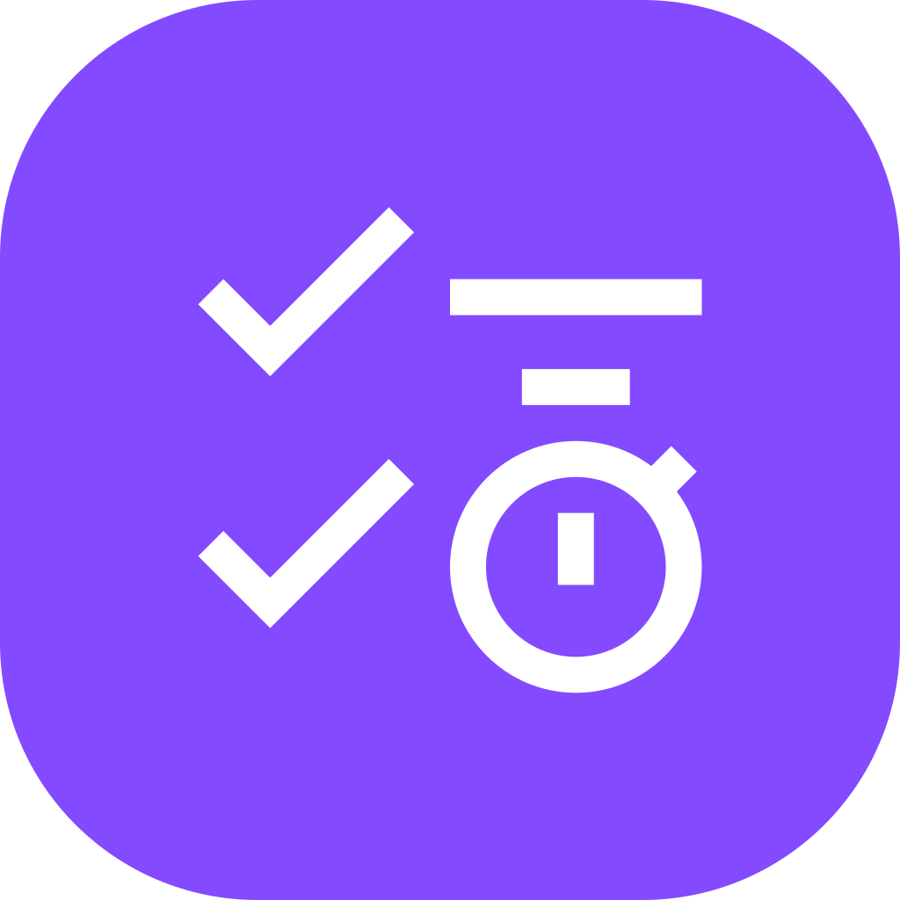
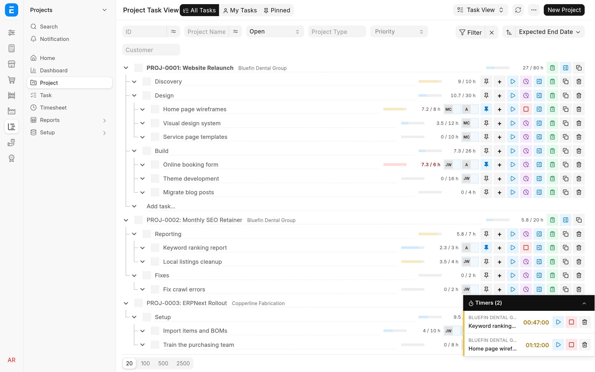

<!-- Copyright (c) 2026, Avunu LLC and contributors
For license information, please see license.txt-->

<!-- frappe-nix:begin header -->

<div align="center">



# TaskView for ERPNext

Project task tree with timers, hour budgets and a customer portal for ERPNext

[](https://github.com/Avunu/erpnext_taskview/actions/workflows/ci.yml)
[](https://github.com/Avunu/erpnext_taskview/releases)
[](license.txt)
[](https://github.com/frappe/frappe/tree/version-16)

<picture>
  <source media="(prefers-color-scheme: dark)" srcset="docs/screenshots/task-view-dark.webp">
  
</picture>

</div>

<!-- frappe-nix:end header -->

## Overview

ERPNext's stock Project and Task screens are built for keeping records, not for running a day of work. This app turns them into a workspace. Staff see every project as a tree of tasks in the desk, start a timer with one click and watch logged hours against each budget. Customers get a portal at `/projects` where they follow their projects, add tasks, comment and attach files without a desk login.

It is for service teams that bill by the hour and want their clients to see the same picture they do. It needs ERPNext on Frappe v16 and adds no DocTypes of its own: it works on ERPNext's Project, Task and Timesheet.

The full documentation is at [docs.avunu.net/erpnext-taskview](https://docs.avunu.net/erpnext-taskview/). Its Markdown source is in [`docs/`](docs/README.md).

## Features

### Task View (desk)

- **Task View**, a list view for Task and Project and the default for both, shows each project as a tree of tasks and subtasks.
- Drag and drop to reorder tasks and to move them under another task or into another project (while the sort is **Manual**).
- Add tasks inline, or several subtasks at once with one title per line. Rename by double-clicking the title, open the full Task or Project form in a side panel, assign staff and complete a task with its checkbox.
- **All Tasks**, **My Tasks** and **Pinned** switch between every project, the tasks assigned to you (with their parents) and your own ordered shortlist.
- **Pinned** has quick entry: type a title and press Enter to add a pinned task, then choose its project later from the chip on the row. Pinning a task also assigns it to you.
- Select tasks with Ctrl-click or Shift-click and copy them, with their subtasks and descriptions, as a nested Markdown checklist.

### Timers

- Start, pause and stop a timer on any task that has a project. Only one runs at a time: starting one pauses the others.
- Time is logged to a draft Timesheet for your Employee and the project, which is created when there is none. Stopping opens a **Log Timer** dialog for the hours, activity type, description and billable time.
- A timer dock on every desk page shows your open timers with a live clock. Timers are kept on the server, so they survive a reload and follow you between devices.
- Submitting a Timesheet only moves a task forward (Open to Working). A task in Pending Review or Completed stays where it is.

### Hour budgets

- Tasks and projects with a budget show a meter such as `12.5 / 20 h`, amber from 80 % and red when over budget.
- A task's budget is its **Expected Time**, else the sum of its subtasks' budgets. A project's is its **Budgeted Hours** (a field the app adds), else the sum of its top-level tasks.
- Logged hours are live: they count draft and submitted Timesheets and running timers, and include all subtasks.

### Customer portal (`/projects`)

- Customers see only their own projects: an overview with a budget per phase and recent activity, tasks as a list or a kanban board, and each task's description, time log, comments and files.
- They can drag cards between the Open, Working, Pending Review and Completed columns, add tasks (optionally under an open phase), comment and attach files.
- The team gets a **Client Portal** notification, and an e-mail by their notification settings, when a customer adds a task, comments, attaches a file or moves a task.
- Staff can open the portal too, with their own permissions, to see what customers see.

<!-- frappe-nix:begin compatibility -->

## Compatibility

| Frappe | Branch       |
| ------ | ------------ |
| v16    | `version-16` |

| Requires                                     | Version            |
| -------------------------------------------- | ------------------ |
| [erpnext](https://github.com/frappe/erpnext) | `>=16.0.0,<17.0.0` |

<!-- frappe-nix:end compatibility -->

<!-- frappe-nix:begin installation -->

## Installation

On Frappe Cloud, install TaskView for ERPNext from the [Frappe marketplace](https://cloud.frappe.io/marketplace/apps/erpnext_taskview).

On a bench of your own:

```bash
bench get-app https://github.com/Avunu/erpnext_taskview --branch version-16
bench --site <site> install-app erpnext_taskview
```

<!-- frappe-nix:end installation -->

Until the first release creates the `version-16` branch, install from `main` instead: `bench get-app https://github.com/Avunu/erpnext_taskview --branch main`. Install it on a site that already has ERPNext.

`bench get-app` builds the app's assets, which include the portal. If you install from a checkout without building, run `bench build --app erpnext_taskview`: without it `/projects` has nothing to show. See [Install and upgrade](docs/install.md).

## Configuration

There is no settings page. The app works through fields on documents you already use, a few ERPNext settings and one developer hook. [Configuration](docs/configuration.md) lists them all, with everything the app adds to a site.

- **Timers:** each person who times work needs an Employee whose **User ID** is their login. In **Projects Settings**, tick both **Ignore User Time Overlap** and **Ignore Employee Time Overlap**: a paused timer's time log overlaps the one that ran meanwhile, and without these ERPNext refuses the next timer on that project and the Timesheet's submission.
- **Budgets:** set **Expected Time** on tasks and **Budgeted Hours** on projects.
- **Portal access:** a portal user sees a project when their Contact is linked to the project's customer, when they are in the customer's **Portal Users**, or when they are in the project's **Users**. See [Giving customers access](docs/client-portal/administering-access.md).
- **Portal set-up on a fresh install:** `install-app` marks the app's one-time patch as done without running it. On a new site, set **Default Portal Home** to `/projects` and untick ERPNext's own `/project` row in **Portal Settings**, **Portal Menu**, and enable **Client Portal** e-mails for existing users from the Notification Type's **Actions** menu. See [Finish the portal set-up](docs/install.md#finish-the-portal-set-up). On a site that had the app before, `bench migrate` runs the patch.
- **Choosing the Timesheet:** another app can decide which draft Timesheet a timer adds to with the `taskview_find_timesheet` hook. See [Choose which Timesheet receives time](docs/configuration.md#choose-which-timesheet-receives-time).

## How It Works

- The desk bundles (`app_include_js`) register a `Tasks` list view for Task and Project and mount a Vue tree in place of the list, and mount the timer dock once on every desk page. Two property settings make Task View the default view of both.
- The tree reads everything through one endpoint, `erpnext_taskview.erpnext_taskview.api.get`, and every change goes through a small set of endpoints that return a fresh copy of the data. Timer operations are rows of an ordinary Timesheet: four read-only fields on Timesheet Detail (Paused, Start Time, Paused Time and Task Subject) hold the timer state, and the server keeps at most one timer running.
- Pins are the current user's ToDos for a task with a **Pinned** (`pin`) field the app adds to ToDo, created through Frappe's assignment code, which is why pinning also assigns.
- `budget.py` computes budgets and logged hours for any number of projects in four queries and rolls them up by `parent_task`. The desk and the portal share it.
- The portal is a frappe-ui app built into `erpnext_taskview/public/portal/` and served at `/projects` by `www/projects.py`. Customers hold no permission on Project or Task, so every portal endpoint (`erpnext_taskview.portal.api`) checks access in `portal/access.py` first and only then reads or writes on the customer's behalf. Rich text from customers is cleaned with `nh3`.
- `extend_doctype_class` extends ERPNext's Task (so that a portal save can close assignments and update parent and dependent tasks for a customer), Timesheet (the forward-only status update) and Timesheet Detail.

[How it works](docs/development/architecture.md) goes into the details.

## Limitations

- Timers need the two overlap settings in **Projects Settings** ticked, and the app does not tick them for you. Since ERPNext 16.51.0 the user check applies to every Timesheet, so a site that worked on an older ERPNext can start refusing timers after an upgrade.
- A fresh install does not run the portal patch, so the portal settings above are yours to make, and until you untick ERPNext's `/project` row the portal menu lists **Projects** twice.
- Dragging works only while the sort is **Manual**.
- Task View has no form for adding time without a timer; add a Timesheet row with its **Project** and **Task** in ERPNext. The app adds no reports.
- In the portal, the board's four columns, the file types customers may attach (JPG, PNG, GIF, PDF, TXT, CSV, Word and Excel documents, OpenDocument text and spreadsheets, and MP4 and QuickTime videos) and the limit of 60 new tasks, 60 comments and 60 uploads per hour from one IP address are fixed in the code. Customers cannot paste images into comments; they attach them as files.
- Customers see the descriptions on time entries and the budget per phase. Do not put anything in a time log description you would not show the customer.

<!-- frappe-nix:begin support -->

## Support

- Bug reports and questions: [GitHub issues](https://github.com/Avunu/erpnext_taskview/issues)
- E-mail: <mail@avu.nu>

<!-- frappe-nix:end support -->

<!-- frappe-nix:begin development -->

## Development

```bash
nix develop        # or: direnv allow
prek install       # the git hooks CI runs
frappe-test        # the tests, the way CI runs them
```

The managed files, checks and release flow are described in the [app standards documentation](https://docs.avunu.net/frappe-nix/docs/app-standards/).

<!-- frappe-nix:end development -->

The yarn commands, the build, the source layout and the tests are described in [Develop TaskView for ERPNext](docs/development/README.md).

<!-- frappe-nix:begin license -->

## License

MIT, Copyright (c) 2025–present Avunu LLC → [license.txt](license.txt)

<!-- frappe-nix:end license -->
