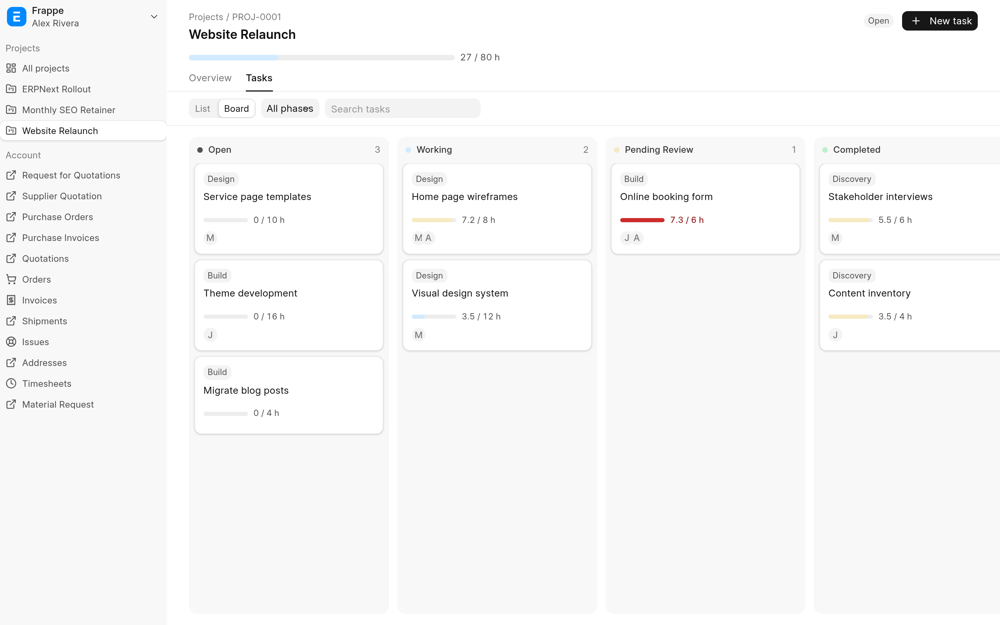

ERPNext's stock project and task screens are built for record keeping. TaskView for ERPNext turns them into a workspace for running a day of work. Your team sees every project as a tree of tasks, starts a timer with one click and watches hours against budget while they work. Your customers get a portal at `/projects` where they follow progress, add tasks, comment and attach files.

It is for service teams that bill by the hour and want clients to see the same picture they do. It runs on Frappe v16 and is free software under the [MIT licence](../license.txt).

## What you get

### A project and task tree for staff

Task View is the default list view for both Task and Project. Each project is a tree of tasks and subtasks that you can drag to reorder or re-parent, edit in place, and fill with quick entry. **All Tasks**, **My Tasks** and **Pinned** switch between everything, your assignments and your personal shortlist, and a side panel opens the full form without leaving the tree. See [Work the task tree](task-view/README.md).

### Timers that log to Timesheets

Start, pause and stop a timer on any task. The time goes to a draft Timesheet as you work, and a floating dock on every desk page shows what is running. See [Timers and timesheets](task-view/timers.md).

### Hour budgets

Tasks and projects with a budget show a meter such as `12.5 / 20 h` that turns amber at 80% and red when over. Budgets roll up from subtasks, and logged hours are live: draft timesheets and running timers count. See [Hour budgets](task-view/hour-budgets.md).

### A client portal

Customers sign in to `/projects` and see only their own projects: an overview with a budget per phase, tasks as a list or a kanban board, time logs, comments and files. When a customer acts, the team is notified. See [The client portal](client-portal/README.md).

## Where to start

| You are                         | Read                                                                                                                                       |
| ------------------------------- | ------------------------------------------------------------------------------------------------------------------------------------------ |
| Staff working in the desk       | [Work the task tree](task-view/README.md), then [Timers and timesheets](task-view/timers.md) and [Hour budgets](task-view/hour-budgets.md) |
| A client with a portal login    | [Using the client portal](client-portal/using-the-portal.md)                                                                               |
| The administrator setting it up | [Install and upgrade](install.md), [Configuration](configuration.md) and [Giving customers access](client-portal/administering-access.md)  |
| Anyone who hits an error        | [Limitations and troubleshooting](troubleshooting.md)                                                                                      |
| A developer changing the app    | [Development](development/README.md) and [How it works](development/architecture.md)                                                       |

## Requirements

- A bench with Frappe v16. The app declares `frappe >=16.0.0,<17.0.0`.
- ERPNext on the same site. The app declares `erpnext >=16.0.0,<17.0.0` and lists ERPNext in `required_apps`. It extends ERPNext's Task, Timesheet and Timesheet Detail classes, so install ERPNext first and TaskView after it.
- Node and yarn on the machine that builds the app. `bench build` runs the app's `yarn build`.
- For timers: an Employee for each person who times work, and the two overlap settings in **Projects Settings** ticked. See [Allow overlapping time logs](install.md#allow-overlapping-time-logs).

> [!NOTE]
> These pages describe the code in the repository. Where a statement depends on Frappe's or ERPNext's own behaviour, the page says so and names the version it was checked against (Frappe 16.34 and ERPNext 16.35).

## Source and changes

The source is at [github.com/Avunu/erpnext_taskview](https://github.com/Avunu/erpnext_taskview). Releases are made by release-please and listed on the [GitHub releases page](https://github.com/Avunu/erpnext_taskview/releases), each with its release notes. No release has been published yet, so until the first one the record of what changed is the [merged pull requests](https://github.com/Avunu/erpnext_taskview/pulls?q=is%3Apr+is%3Amerged) and the [commits on `main`](https://github.com/Avunu/erpnext_taskview/commits/main), written as conventional commits (`feat:`, `fix:`, `chore:`). The first release also starts a `CHANGELOG.md` at the root of the repository.

Milestones so far:

| Date       | Change                                                                                                  |
| ---------- | ------------------------------------------------------------------------------------------------------- |
| 2026-10-02 | Hour budgets in Task View and the customer project portal (pull request 27)                             |
| 2026-10-05 | The portal moves to frappe-ui 1.0                                                                       |
| 2026-10-05 | Quick task entry and a project picker in the Pinned view                                                |
| 2026-10-06 | Complete MIT licence text and portal documentation in the README (pull request 30)                      |
| 2026-10-16 | A copy button on each Task View row copies tasks as Markdown, with their descriptions (pull request 38) |
