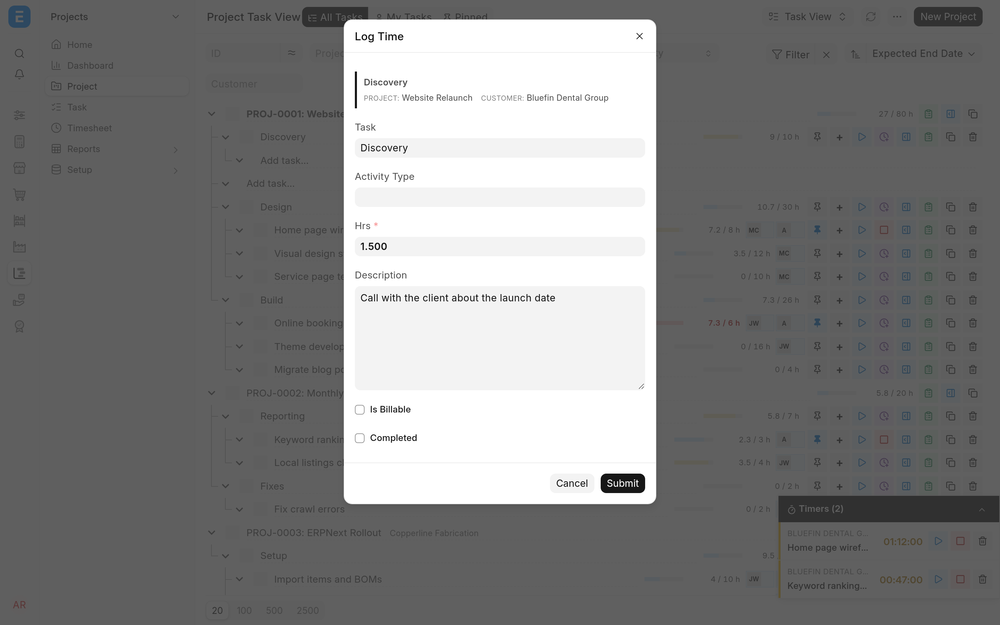

Timers live on task rows in [Task View](README.md). Every timer is a row in the time logs of an ordinary ERPNext Timesheet, so submitting, billing and reporting work as they do in stock ERPNext.

## Before you start

- The task needs a project. Project rows have no timer buttons, because time is always logged against a task. A pinned task that has no project yet cannot be timed until you [give it one](README.md#give-a-task-a-project).
- Your user must be the **User ID** of an Employee. Timesheets are created for that Employee.
- You need read access to the task's project and write access to the task itself, and time is always logged on the task's own project: ERPNext's **Projects User** role gives both. A user who can only see the task gets **Insufficient Permission** when they start, stop or log time on it. The Timesheet must be your Employee's, one you created, or one your role lets you write, so you cannot stop or discard someone else's timer unless you may edit their Timesheet in ERPNext. A submitted or cancelled Timesheet is never changed from here. When you stop a timer, you can move it only to another task of the same project.
- An administrator must tick **Ignore User Time Overlap** and **Ignore Employee Time Overlap** in Projects Settings. Pausing one timer to run another makes their time logs overlap, and without these settings ERPNext refuses the next timer on that project and the Timesheet's submission. See [Allow overlapping time logs](../install.md#allow-overlapping-time-logs).

## Time a task

1. Click the play button on a task row. The tree opens up to the task so you can see it.
2. Work. The floating timer dock appears on every desk page, not only in Task View, and shows each open timer with a live `HH:MM:SS` clock.
3. Click pause when you step away, and play to resume.
4. Click stop (the square) when you finish. The **Log Timer** dialog opens with the elapsed hours filled in.
5. Check the dialog and click **Submit**.

The stop button only appears on a row while it has a timer; in its place, a row without a timer shows the **Log time** button (see [Log time without a timer](#log-time-without-a-timer)). Timers are kept on the server, so a running timer survives a page reload and is the same on every device you sign in from.

Only one timer runs at a time. Starting or resuming a timer pauses whichever one was running. Paused timers stay in the dock until you stop or discard them.

## The Log Timer dialog

Stopping pauses the clock first, then asks you to confirm.

| Field         | Notes                                                                                                            |
| ------------- | ---------------------------------------------------------------------------------------------------------------- |
| Task          | Defaults to the timed task. You can move the time to another task in the same project.                           |
| Activity Type | Optional.                                                                                                        |
| Hrs           | Filled from the clock. What you leave here is what gets logged, so edit it if the clock ran while you were away. |
| Description   | What you did.                                                                                                    |
| Is Billable   | Marks the entry billable.                                                                                        |
| Billable Time | Appears when Is Billable is ticked, and starts at the same value as Hrs. Left empty, it is saved as Hrs.         |
| Completed     | Marks the log complete and sets the task to Completed.                                                           |

**Cancel** closes the dialog and resumes the timer, even if you had paused it before you pressed stop.

If you tick **Completed** on a task that still has subtasks that are not Completed, the time is logged, the task is not completed, and a notice tells you how many subtasks are in the way. A Cancelled subtask counts as not Completed.

The row's To Time is set to its From Time plus the hours you confirmed, so the stored time range always agrees with the hours.

## Log time without a timer

For hours you did not time, such as a call or work done away from the desk, use the **Log time** button (the clock with a plus) on the task row. It appears on a task that has a project and no timer; while a task has a timer, log its time with stop instead.

<picture>
  <source media="(prefers-color-scheme: dark)" srcset="../screenshots/log-time-dark.webp">
  
</picture>

1. Click **Log time** on the task row. The **Log Time** dialog opens with the task, its project and its customer at the top.
2. Enter **Hrs**. It is required and must be more than zero.
3. Fill in the other fields as in [the Log Timer dialog](#the-log-timer-dialog), and click **Submit**.

The entry ends at the moment you submit and starts the given hours earlier. It goes to the same draft Timesheet a timer on that project would use, created if there is none, and the budget meters count it straight away. **Completed** works as it does when you stop a timer: it completes the task unless the task has subtasks that are not Completed, or ERPNext refuses to complete it (for example because a task it depends on is still open). The time is logged either way, and a notice says why the task stayed open. **Cancel** just closes the dialog.

Each entry is a new time log, so logging time never touches a timer you have open on another task.

## The timer dock

The dock is a small floating window that shows every open timer you own, whatever project it belongs to. It hides itself when there are none.

- Drag its header to move it, and drag its side edges to resize it. Its position and width are kept for your browser session.
- The chevron collapses it to one line that still shows the running timer and its clock.
- Click a card to expand it and write a description ("What are you working on?"). It saves when you leave the field, or 30 seconds after you start typing, and it carries into the Log Timer dialog.

> [!WARNING]
> The trash button means different things in two places. On a **task row** it deletes the task. On a **dock card** it discards the timer: the time entry is deleted, and so is the draft Timesheet if that was its only entry. Check which one you are pointing at.

## Where the time goes

When you start a timer, TaskView looks for a draft Timesheet that has your Employee and the project, and appends a row to it. If there is none it creates one, with the project's customer filled in. Later timers on the same project reuse that draft until you submit it. To change that policy, a developer can use the [`taskview_find_timesheet` hook](../configuration.md#choose-which-timesheet-receives-time).

Each row records the project and the task, which is how [budgets](hour-budgets.md) and the [client portal](../client-portal/README.md) find it. The app adds four read-only fields to Timesheet Detail to hold timer state: Paused, Start Time, Paused Time and Task Subject.

### Submitting a Timesheet

Submitting moves a task forward only: Open becomes Working, and a task that is Pending Review or Completed stays where it is. A task someone has already approved does not slip back to Working because a Timesheet was submitted. If every log of a task on the Timesheet has **Completed** ticked, submitting also completes the task.

### Adding time on another day

**Log time** always logs hours that end now. For time on another day, change the row's **From Time** in the draft Timesheet afterwards, or add a row to a Timesheet in ERPNext and fill in its **Project** and **Task**: budgets and the portal count a row only through those fields.

## Reporting

TaskView does not add a report. Read the meters on the project and its phases for a quick answer, and use the standard Timesheet list or report view, filtered by project, employee or date, for the entries themselves. Billing from Timesheets works as in stock ERPNext.

> [!NOTE]
> Customers see the same figures in the portal, including the descriptions on time entries and a budget per phase. See [Giving customers access](../client-portal/administering-access.md#what-customers-can-see).
